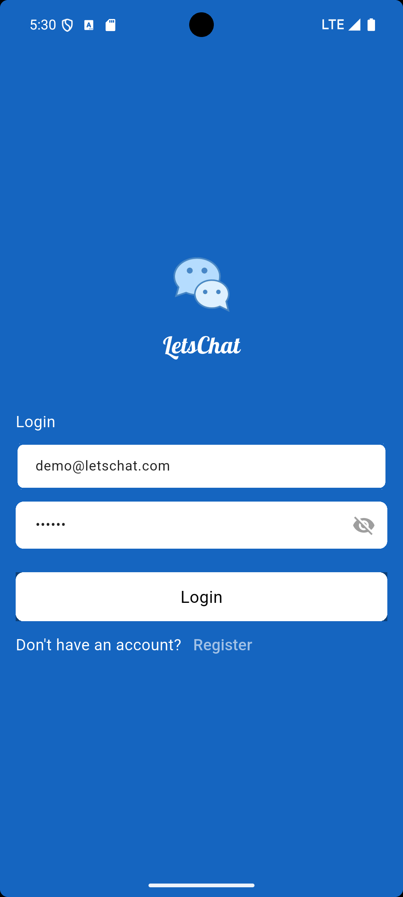
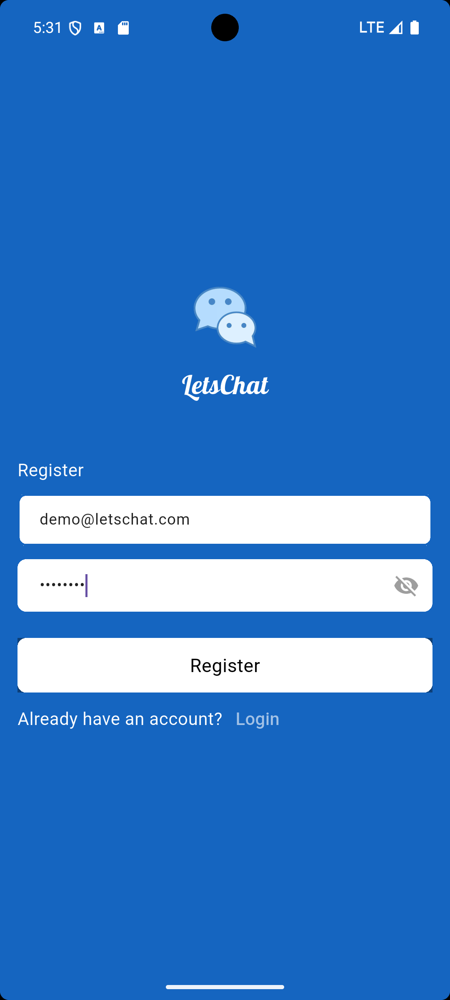
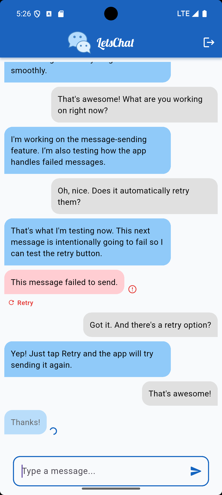
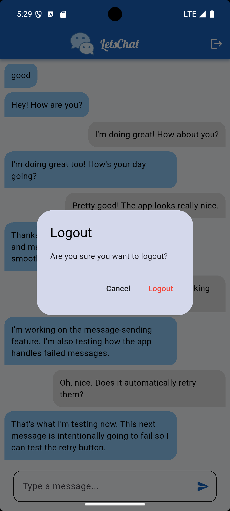

# Let's Chat

Let's Chat is a real-time chat application built with Flutter and Firebase. It demonstrates a maintainable Clean Architecture structure, Cubit-based state management, and resilient message delivery with optimistic UI updates.


## Features

- **Authentication** — Email/password registration, login, session restoration, and logout confirmation.
- **Real-time messaging** — Send and receive messages through Cloud Firestore.
- **Optimistic UI** — Show messages immediately with pending, failed, and retry states.
- **Reliable synchronization** — Reconcile local messages with Firestore data and use stable client IDs to avoid duplicates during retries.
- **Cursor-based pagination** — Load older messages without retrieving the entire conversation.
- **Layered architecture** — Keep presentation, domain, and data responsibilities separate.
- **Automated quality checks** — Run static analysis and tests in GitHub Actions.

## Screenshots

<p align="center">
  
  
  
  
</p>

## Technology

- [Flutter](https://flutter.dev/) and Dart
- [Firebase Authentication](https://firebase.google.com/docs/auth)
- [Cloud Firestore](https://firebase.google.com/docs/firestore)
- [flutter_bloc](https://pub.dev/packages/flutter_bloc) and Cubit
- [Equatable](https://pub.dev/packages/equatable)
- [bloc_test](https://pub.dev/packages/bloc_test)
- [mocktail](https://pub.dev/packages/mocktail)
- GitHub Actions

## Architecture

The application is organized into three layers:

```text
Presentation  Screens, widgets, and Cubits
Domain       Entities, repository contracts, and use cases
Data         Models, repository implementations, and Firebase integration
```

This separation keeps application logic testable without requiring a live Firebase connection and makes infrastructure concerns replaceable.

## Message delivery

When a user sends a message, the application:

1. Adds a local message to the conversation immediately.
2. Marks it as pending while the Firestore write is in progress.
3. Reconciles the local message with the persisted Firestore record after success.
4. Shows a failed state with a retry action if the write fails.

Persisted message timestamps use Firestore server timestamps. Optimistic messages may use a local timestamp until they are reconciled with the server. See [TIMESTAMP_SEMANTICS.md](TIMESTAMP_SEMANTICS.md) for the timestamp design notes.

## Getting started

### Prerequisites

- Flutter SDK with Dart 3.6 or later
- A Firebase project
- Firebase Authentication with the Email/Password provider enabled
- A Cloud Firestore database
- FlutterFire CLI

### 1. Clone the repository

```bash
git clone https://github.com/kawtharrashid/lets_chat.git
cd lets_chat
```

### 2. Install dependencies

```bash
flutter pub get
```

### 3. Configure Firebase

The repository does not include a real Firebase configuration. The CI-safe template at [`lib/core/firebase_options.dart.example`](lib/core/firebase_options.dart.example) contains placeholder values and cannot connect to a Firebase project.

To configure a local project:

```bash
dart pub global activate flutterfire_cli
flutterfire configure
```

Then:

1. Enable Email/Password authentication in the Firebase console.
2. Create or configure a Cloud Firestore database.
3. Confirm that FlutterFire generated `lib/core/firebase_options.dart`.
4. Review your Firestore Security Rules before deploying them to any shared or production environment.

Never commit service-account credentials, private keys, or other server-side secrets. Read [`SECURITY.md`](SECURITY.md) for configuration and Firebase security guidance.

### 4. Run the application

```bash
flutter run
```

## Testing and analysis

Run the test suite:

```bash
flutter test
```

Run static analysis:

```bash
flutter analyze
```

The tests use mocked dependencies and do not require a live Firebase connection.

## Continuous integration

The workflow in [`.github/workflows/ci.yml`](.github/workflows/ci.yml) runs on pushes to `main` and on pull requests targeting `main`. It:

1. Installs Flutter dependencies.
2. Uses the Firebase configuration template.
3. Runs `flutter analyze`.
4. Runs `flutter test --coverage`.
5. Uploads the generated coverage report as a workflow artifact.

## Security

Firebase client configuration values are not substitutes for access control. Restrict API keys where appropriate and enforce authorization, validation, and data access rules in Firestore Security Rules. See [`SECURITY.md`](SECURITY.md) before deploying the application.

## Author

**Kawthar Rashid** — Flutter Developer

- GitHub: [kawtharrashid](https://github.com/kawtharrashid)
