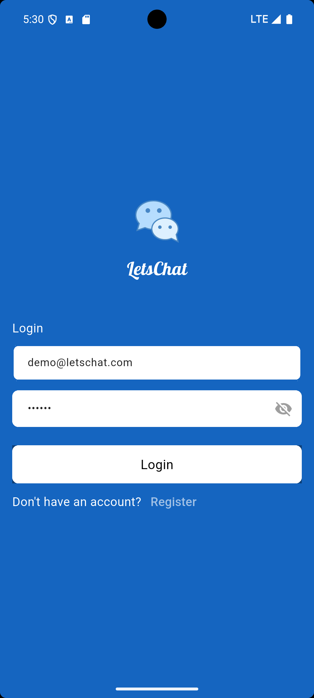
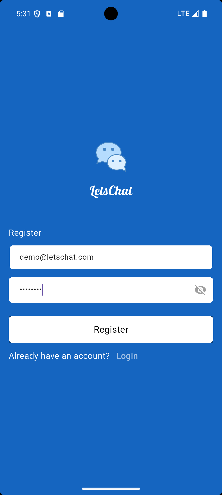
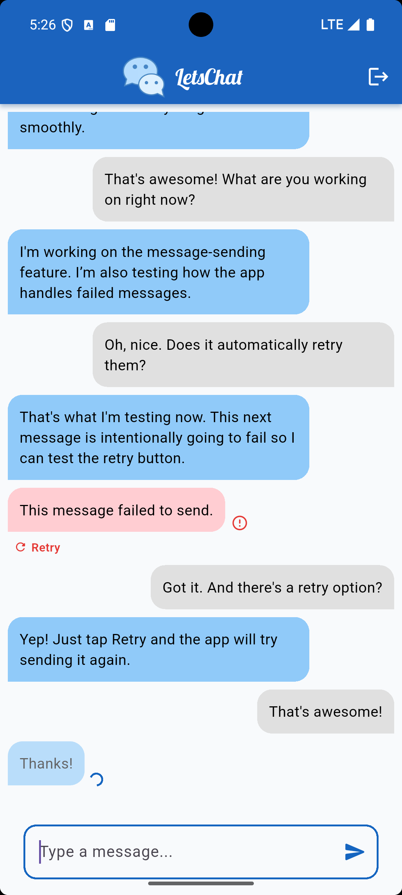
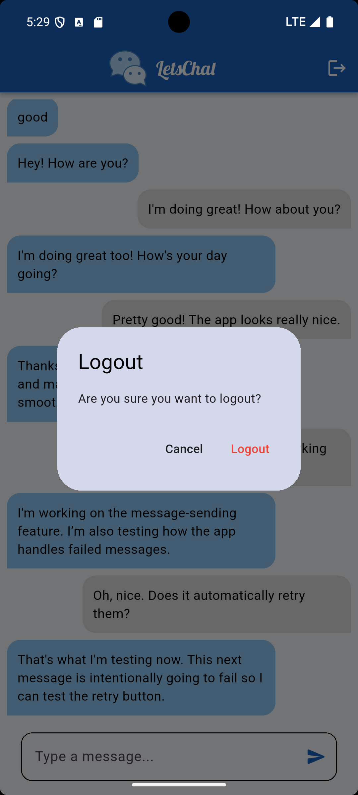

Let's Chat 💬

Let's Chat is a real-time chat application built with Flutter and Firebase. It follows Clean Architecture principles and uses Cubit for state management.

The project demonstrates authentication, real-time messaging, optimistic UI updates, message pagination, and testable application logic.

📸 Screenshots

     

✨ Features
Authentication: Email/password registration, login, session restoration, and logout confirmation.
Real-Time Messaging: Send and receive messages using Cloud Firestore.
Optimistic UI: Messages appear immediately, with pending and failed states and a retry option.
Message Pagination: Load older messages using cursor-based pagination.
Clean Architecture: Separate presentation, domain, and data layers.
Testing: Unit, Cubit, and widget tests using bloc_test and mocktail.
Security: Firestore Security Rules for controlling message access.
CI: Automated testing and static analysis with GitHub Actions.
🛠️ Tech Stack
Flutter and Dart
Firebase Authentication
Cloud Firestore
flutter_bloc (Cubit)
Equatable
bloc_test and mocktail
GitHub Actions
🏗️ Architecture

The project separates responsibilities into three layers:

Presentation: Screens, widgets, and Cubits (AuthCubit, ChatCubit).
Domain: Entities, repository contracts, and use cases.
Data: Repository implementations, models, and Firebase integration.

This separation improves maintainability and allows application logic to be tested without depending on live Firebase services.

⚡ Optimistic Messaging

When a user sends a message, it appears immediately in the chat.

Pending messages display a loading indicator.
Successful messages are reconciled with Firestore data.
Failed messages display an error state and can be retried.
Stable message IDs help prevent duplicate records during retries and synchronization.

Firestore server timestamps are the source of truth for persisted message timestamps. See TIMESTAMP_SEMANTICS.md for details.

🚀 Getting Started
Prerequisites
Flutter SDK
A Firebase project
Firebase Authentication with Email/Password enabled
Cloud Firestore
1. Clone the Repository
git clone https://github.com/kawtharrashid/lets_chat.git
cd lets_chat

2. Install Dependencies
flutter pub get

3. Configure Firebase

The repository does not include the author's real Firebase configuration.

The example file at lib/core/firebase_options.dart contains placeholder values and will not connect to a real Firebase project.

To configure your own project:

Create a project in the Firebase Console.
Enable Email/Password authentication and create a Firestore database.
Install the FlutterFire CLI and configure the application:
   dart pub global activate flutterfire_cli
   flutterfire configure

Ensure the generated configuration matches the file path imported by the application.

Review firestore.rules before deploying your security rules. Never deploy unreviewed or permissive rules to production.

4. Run the Application
flutter run

Note: Firebase client configuration is not necessarily secret, but database access must be protected by appropriate security rules. Never commit service-account credentials or private keys.

🧪 Testing

Run the test suite:

flutter test

Run static analysis:

flutter analyze

Unit and Cubit tests use mock dependencies, so they do not require a live Firebase connection.

⚙️ Continuous Integration

GitHub Actions is configured to run tests and static analysis through .github/workflows/ci.yml.

👩‍💻 Author

Kawthar Rashid — Flutter Developer

- GitHub: [github.com/kawtharrashid](https://github.com/kawtharrashid)
